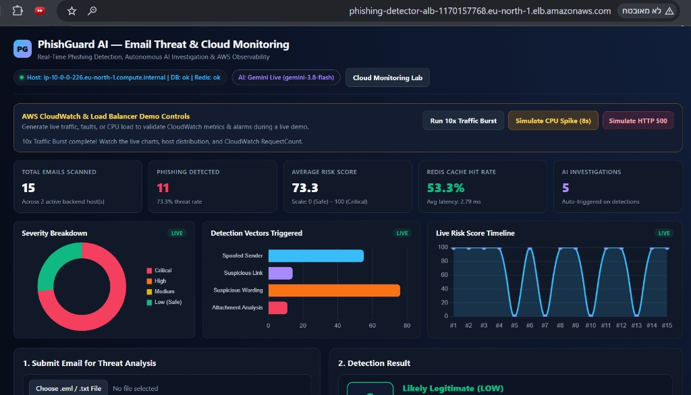
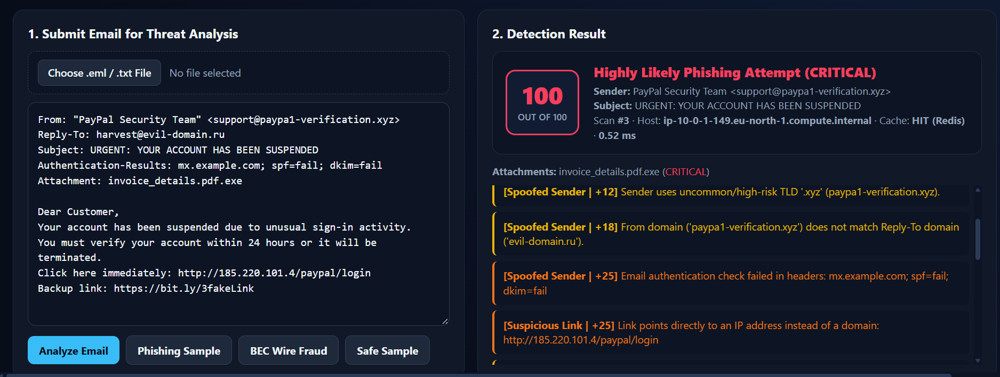
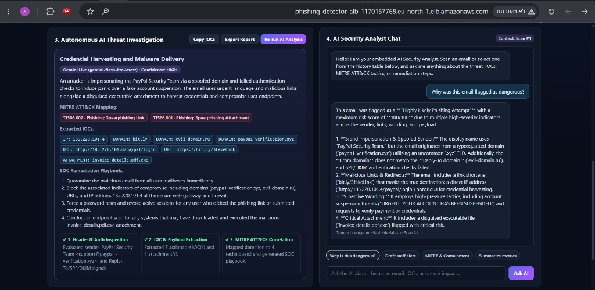
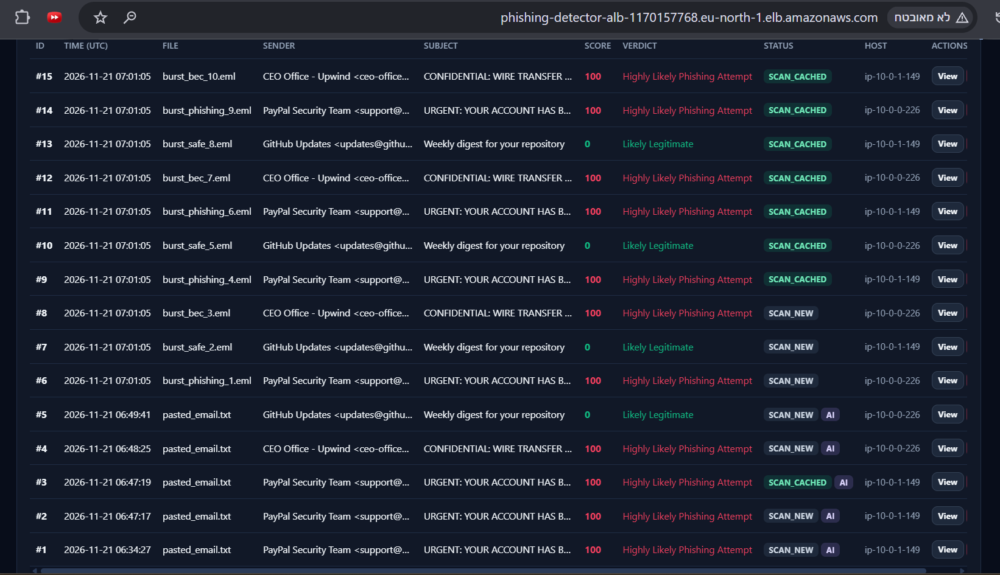
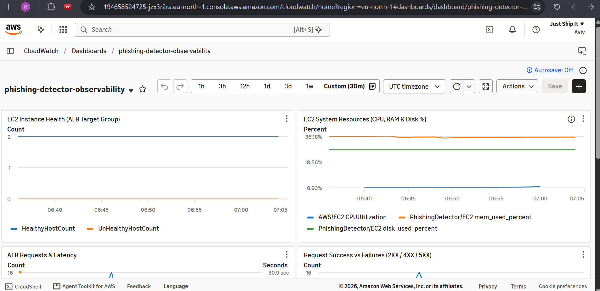
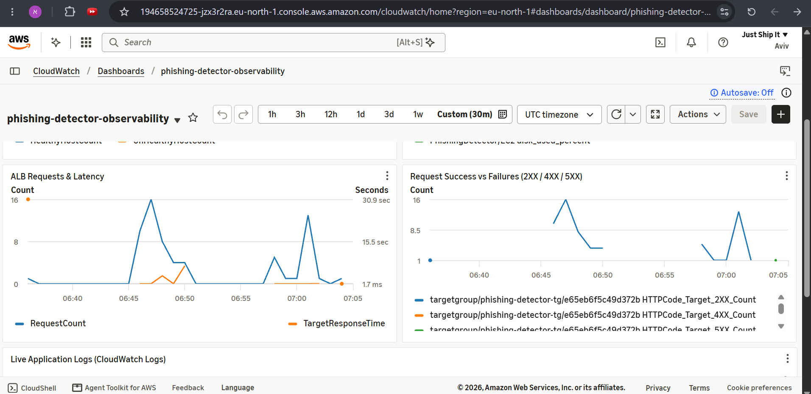
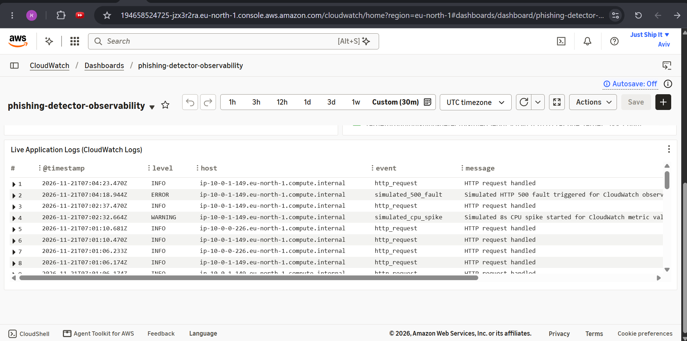

# PhishGuard AI — Email Phishing Detector & AWS Cloud Monitoring

## Overview
A full-stack, cloud-native **Email Phishing Detection & Autonomous AI SOC Platform** deployed on AWS using Terraform, built for high availability, security-by-design, and end-to-end observability.

## Stand-Out Capabilities
- **Multi-Signal Phishing Engine (CLI + Web + API):** Analyzes spoofed senders (Levenshtein + homoglyph normalization + SPF/DKIM/DMARC), deceptive links (IP literals, Punycode, shorteners, HTML anchor mismatches), social engineering / BEC language, and dangerous/double-extension attachments.
- **Autonomous AI Threat Investigation:** Automatically triggers after every detected threat to classify the attack, extract actionable IOCs, map findings to **MITRE ATT&CK**, and produce a SOC containment playbook (powered by Google Gemini API via AWS SSM Parameter Store, with a deterministic autonomous SOC fallback engine).
- **Embedded AI Security Analyst Chat:** Context-aware SOC assistant built directly into the dashboard for querying active detections, drafting employee warning advisories, and summarizing live threat telemetry.
- **Real-Time Live Telemetry & Charts:** Dynamic Chart.js visual analytics updating on every scan (severity breakdown, triggered attack vectors, risk timeline, Redis cache hit rate, and ALB host distribution).
- **Cloud Monitoring & Chaos Lab:** Built-in demo controls to run traffic bursts, simulate HTTP 500 faults, and trigger controlled CPU spikes to validate CloudWatch metrics & alarms live.

## AWS Architecture (Terraform)
- **High Availability:** Auto Scaling Group (`2x t3.micro`) across 2 Availability Zones in `eu-north-1` behind an Application Load Balancer (`/health` checks).
- **Persistence & Caching:** Encrypted Amazon RDS (PostgreSQL 16) + Amazon ElastiCache (Redis) in private subnets with graceful cache fallback.
- **Security Best Practices:** Zero SSH exposure (SSM Session Manager only), IMDSv2 enforced, least-privilege IAM instance profile, private S3 artifact bucket, and secrets stored as `SecureString` in SSM Parameter Store.
- **Observability:** CloudWatch Agent for RAM/Disk metrics + structured JSON logs, paired with a Terraform-managed CloudWatch Dashboard and Alarms (`UnHealthyHostCount`, `CPUUtilization`, `HTTPCode_Target_5XX_Count`).

## Local Usage
```powershell
pip install -r requirements.txt
python cli.py sample_emails/phishing_sample.eml --investigate
$env:GEMINI_API_KEY="YOUR_GEMINI_KEY"
uvicorn app.main:app --reload --port 8000
```

## AWS Deployment (Terraform)
```powershell
cd terraform
terraform init
$env:TF_VAR_gemini_api_key="YOUR_GEMINI_KEY"
terraform apply
```

Always tear down cloud resources when finished:
```powershell
terraform destroy
```

## Live AWS Verification & Observability Screenshots

### 1. Real-Time Dashboard & Traffic Burst Telemetry


### 2. ElastiCache Redis Performance (Cache HIT — 0.52 ms)


### 3. Autonomous AI Threat Investigation & Analyst Chat (Gemini Live)


### 4. Multi-AZ Load Balancing & Persistent History (Amazon RDS PostgreSQL)


### 5. AWS CloudWatch — EC2 Health & Custom Agent Metrics (CPU, RAM, Disk)


### 6. AWS CloudWatch — ALB Traffic, Latency & 5XX Fault Detection


### 7. AWS CloudWatch — Live Structured JSON Application Logs
